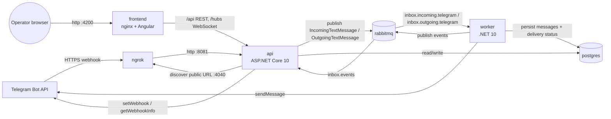

# Architecture (Step #2)

> Internal plan document (English). Source: A1 Architect DESIGN proposal (prompt P-005), reviewed and consolidated by the orchestrator.
> Spanish deliverables (ADR-002, ADR-003, C4) are derived from this document in Step #5 and Step #9.
> Status: **APPROVED (P-007).** Revision 2: separate worker (D-010), queued outbound replies (D-021) with at-least-once delivery (D-030), retry endpoint (D-032) and the serial-send accepted risk (D-035).

## 1. Containers (docker compose)



| Container | Image | Responsibility | Exposed to host |
|---|---|---|---|
| postgres | `postgres:<pinned>-alpine` | Persistence (ADR-001) | no |
| rabbitmq | `rabbitmq:<pinned>-management-alpine` | Incoming queue, DLQ, events fan-out | 15672 (management UI) |
| ngrok | `ngrok/ngrok` | Public HTTPS tunnel to **api:8081 only** | 4040 (inspector) |
| api | .NET 10 aspnet | REST API, SignalR hub, webhook intake, webhook registration, migrations | none (behind nginx) |
| worker | .NET 10 runtime | Consumes the incoming queue (persist) and the outgoing queue (Telegram `sendMessage`, delivery status), runs the outbox sweeper, publishes events | no |
| frontend | nginx + Angular 22 build | Static UI; reverse-proxies `/api` and `/hubs` to api:8080 (single origin, no CORS) | 4200 |

**Security boundary:** the inbox API has no authentication, which is out of scope. ngrok therefore tunnels only to the webhook port 8081, and the webhook endpoint is bound to that port. `/api` and `/hubs` are never public.

## 2. Backend: Clean Architecture

```
Inbox.Domain          ← nothing
Inbox.Application     ← Domain
Inbox.Infrastructure  ← Application, Domain   (EF Core/Npgsql, RabbitMQ.Client 7, Telegram HttpClient, ngrok)
Inbox.Api             ← Application, Infrastructure   (composition root)
Inbox.Worker          ← Application, Infrastructure   (composition root)
tests/Inbox.Domain.Tests ← Domain
```

- **Domain:**
  - `Contact` aggregate: chat id, names, username, `DisplayName`, `UpdateProfile`.
  - `Message` aggregate: `Inbound(...)` / `Outbound(...)` factories, idempotent `MarkAsRead`, and for outbound messages a **delivery state machine** `Pending → Sent | Failed`, `Failed → Pending` (operator retry). Behaviours: `MarkSent(telegramMessageId, sentAt)`, `MarkFailed(reason)`, `RequeueForRetry()`. Invalid transitions throw a domain exception.
  - `MessageText` value object: not blank, at most 4096 characters.
  - `MessageDirection`, `DeliveryStatus`.
  - UTC `DateTimeOffset` only.
- **Application:** one plain handler class per use case (no MediatR): `ProcessIncomingMessage`, `GetContacts`, `GetConversation`, `MarkConversationAsRead`, `QueueReply`, `DeliverReply`, `RetryReply`, `RequeueStalePendingReplies`, `RegisterWebhook`. Ports: `IContactRepository`, `IMessageRepository`, `IUnitOfWork`, `IInboxQueries` (read projections), `ITelegramGateway`, `IIncomingMessagePublisher`, `IOutgoingMessagePublisher`, `IInboxNotifier`, `IPublicUrlProvider`, plus .NET's `TimeProvider`.
- **Infrastructure:** one project, split into folders `Persistence/`, `Messaging/`, `Telegram/`, `Ngrok/`. RabbitMQ.Client is used directly (no MassTransit) so the topology in ADR-003 is visible in the code.
- **`IInboxNotifier` has two adapters:** SignalR in the api, and a RabbitMQ `inbox.events` publisher in the worker.

## 3. Inbound flow (→ ADR-003)

1. Telegram → `POST /telegram/webhook` (api:8081). The api checks `X-Telegram-Bot-Api-Secret-Token` with a constant-time comparison.
2. Only private-chat text `message` updates are accepted. Anything else returns 200 and is logged.
3. The update is mapped to the internal contract `IncomingTextMessage v1` (anti-corruption layer).
4. The message is published as persistent, with publisher confirms. The webhook returns **200 only after the confirm** and **503 if the broker fails**, so Telegram retries.
5. The worker (prefetch 1, manual ack) runs one transaction: load or create the contact through the domain, then `INSERT … ON CONFLICT (telegram_update_id) DO NOTHING` (exact recipe in contracts §7.4), then commit. It then publishes `messageReceived` to `inbox.events` and **acks after commit**. It re-notifies on duplicates as well.
6. The api relay consumes `inbox.events` through an exclusive auto-delete queue and forwards to the SignalR hub.

| Webhook case | Status |
|---|---|
| Bad or missing secret | 401 |
| Authenticated but malformed, or out of scope | 200 (logged, ignored) |
| Text published and confirmed | 200 |
| Broker down, nack or timeout | 503 (Telegram retries) |

**Topology (inbound + outbound):**
```
inbox.incoming (direct) --telegram.text--> inbox.incoming.telegram (quorum, x-delivery-limit=5, DLX=inbox.dlx, dl-rk=incoming)
inbox.outgoing (direct) --telegram.send--> inbox.outgoing.telegram (quorum, x-delivery-limit=5, DLX=inbox.dlx, dl-rk=outgoing)
inbox.dlx (direct) --incoming--> inbox.incoming.telegram.dlq
                   --outgoing--> inbox.outgoing.telegram.dlq
inbox.events (fanout) --> api exclusive auto-delete queue (one per api instance)
```
`inbox.dlx` is a **direct** exchange with a per-queue dead-letter routing key, so each flow keeps its own DLQ.

**Error handling in the worker:** permanent errors are nacked without requeue and go straight to the DLQ. Transient errors get an in-process retry 3 times (1, 2 and 4 s), then are nacked with requeue, and the delivery limit sends them to the DLQ.

**Ordering (changed by queued outbound):** a pending reply has no `telegram_message_id` yet, so that column can't be the ordering key (D-016 changed). History is ordered by **`occurred_at`, then `seq`**:
- `occurred_at` is Telegram's `date` for inbound messages and the moment the operator queued the reply for outbound ones.
- `seq` is a DB identity column that breaks ties, since Telegram dates only have seconds resolution.

A reply stays where the operator wrote it, even if Telegram delivers it later. The contact list is ordered by the latest `occurred_at`.

## 4. Real time (→ ADR-002)

SignalR hub `/hubs/inbox`, server to client only. Events: `messageReceived`, `messageQueued`, `messageStatusChanged` (Sent/Failed and reason), `conversationRead`. The client upserts by id, so duplicate pushes are harmless. On reconnect it refetches the contact list and the open conversation. Runner-up: SSE. Rejected: raw WebSockets (too much custom code) and polling (not real time).

## 5. Webhook auto-registration

An api `BackgroundService` calls the `RegisterWebhook` use case:
1. Poll `ngrok:4040/api/tunnels` with backoff and pick the `https` tunnel.
2. Call `setWebhook(url, secret_token, allowed_updates=["message"], drop_pending_updates=false)`.
3. Verify with `getWebhookInfo`.
4. A **60 s watchdog** re-registers if the ngrok URL changed.

Registration never blocks api startup. The token is never logged.

## 6. Outbound reply: queued (→ ADR-004, human decision P-006)

```
Operator ─POST─► api: QueueReply
                   1. validate MessageText, contact exists (404 otherwise)
                   2. INSERT message (Outbound, status=Pending, ReadAt=occurred_at)   ── the row is the outbox
                   3. publish OutgoingTextMessage v1 {messageId} (persistent, publisher confirm)
                   4. 202 Accepted + Message DTO (status Pending) ; push messageQueued
worker: DeliverReply (prefetch 1, manual ack)
                   5. load message; if status != Pending → ack, done   (idempotent redelivery)
                   6. Telegram sendMessage(chat_id, text)
                   7a. OK            → MarkSent(telegram_message_id, date), commit, push messageStatusChanged, ack
                   7b. 400/403       → MarkFailed("rejected: <desc>"), commit, push, ack           (permanent)
                   7c. 429/5xx/net   → in-process retry 3x (honours retry_after); still failing →
                                        MarkFailed("unavailable"), commit, push, ack
                   7d. poison payload (can't deserialize / message not found) → nack(requeue:false) → DLQ
Operator ─POST /api/messages/{id}/retry─► RetryReply: Failed → Pending, re-publish, 202
worker: RequeueStalePendingReplies (every 30 s)
                   re-publishes Pending messages with last_queued_at older than 60 s ── closes the "committed but never published" gap
```

**Why the message row is the outbox.** If step 3 fails after step 2 commits (a broker outage or a crash), the message would stay Pending forever. There are three options:
- A separate outbox table with a dispatcher. This is the textbook answer but duplicates state.
- A two-phase API call. This doesn't close the crash gap.
- **Use the `Pending` row itself as the outbox and add a sweeper (chosen).** Re-publishing is safe because step 5 is idempotent.

If the broker confirm fails at step 3, the API still returns 202: the message is durably stored as Pending and the sweeper will publish it.

**Delivery guarantee: at-least-once, with a documented duplicate window.** Telegram's `sendMessage` has no idempotency key. If the worker crashes *after* Telegram accepts the message but *before* the `Sent` commit, the redelivery sends it again. That window is milliseconds. The alternative is a `Sending` state that refuses to resend when the outcome is unknown, which turns that window into a possible *lost* reply. For a support inbox a rare duplicate is preferable to a silent loss. This is recorded as a risk in ADR-004.

**Final failures are visible.** After the retries are exhausted, the message is marked `Failed` and acked, instead of being left in the DLQ, so the operator *sees* the failure in the UI and can retry. The DLQ is reserved for poison messages.

**Per-contact ordering:** prefetch 1 with a single consumer keeps queue order. The trade-off is that a Telegram outage pauses all outbound sends during the retries (at most about 7 s per message). This is an **accepted risk (D-035, human P-007)** until volume reaches hundreds of active conversations **and** Telegram is down at the same time. At that point the queue is partitioned per contact (consistent-hash exchange) or retries move to delayed-retry queues. Recorded in ADR-004.

## 7. API surface (frozen in contracts.md during Step #3)

| Endpoint | Purpose |
|---|---|
| `GET /api/contacts` | Contact list: display name, username, unread count, last message; ordered by last activity |
| `GET /api/contacts/{id}/messages` | Full history (no pagination, by scope) |
| `POST /api/contacts/{id}/read` `{upToMessageId}` | Mark read up to what the operator has actually seen (avoids marking a just-arrived message read) |
| `POST /api/contacts/{id}/messages` `{text}` | Queue a reply → 202 (status Pending) / 400 / 404 |
| `POST /api/messages/{id}/retry` | Re-queue a Failed reply → 202 / 404 / 409 (not Failed) |
| `GET /health/live`, `/health/ready` | Healthchecks |
| `POST /telegram/webhook` (:8081 only) | Telegram intake |

Unread count and last message preview are computed **at query time**: a partial index `read_at IS NULL` and an index on `(contact_id, occurred_at DESC, seq DESC)`. There are no denormalized counters. A partial index `WHERE status = 'Pending'` serves the sweeper.

## 8. Risks carried forward

The risks (startup ordering, healthcheck tooling in aspnet images, ngrok free tier with one session and a changing URL, the commit/ack gap, an outbound message sent but not persisted, the single-operator assumption, RabbitMQ.Client channel thread-safety, the Npgsql UTC rule) are tracked in `decisions-log.md` and re-examined in Step #7.

## 9. Facts to re-verify during implementation

The A1 agent recalled these from memory and did not check them in docs. Implementers must confirm them:
- The RabbitMQ.Client 7 publisher-confirm API (`CreateChannelOptions`).
- Quorum `x-delivery-limit` semantics in RabbitMQ 4.x.
- The current postgres and rabbitmq image tags.
- The ngrok free-tier limits.
